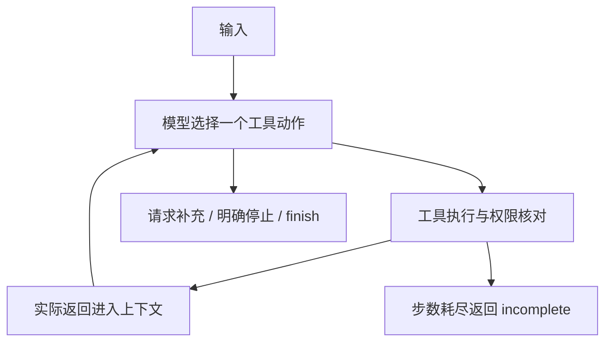

# 调用流程、动态决策与取舍

## 职责

Python3.11标准库，无Agent框架、模型SDK或运行时第三方依赖。model.py为DeepSeek原生HTTP或显式Mock替身；agent.py只运行有界模型/工具循环，不为真实模式预定业务动作。

tools.py保存状态与权限边界；drafting.py生成受限草稿、实际估时并检查；domain.py校验输入及事实必须在素材原文出现；scenarios.py提供资料变更和故障注入，不注入预设Trace。

web.py复用同一Agent和检查器，HTML/JS提供编辑。服务绑定本机，正文输出转义；目标和事实从已存运行加载，不接受客户端伪造批准或覆盖目标。

## 模型循环

动作包括inspect_request、search_materials、read_material、draft_script、revise_script、estimate_duration、check_brand_rules、request_information、stop、finish。预设结构是执行骨架；次序和修订由模型工具调用选择。工具守卫只能拒绝违规，不能替模型生成后续选择。

真实模式每轮接收一个tool_call，将完整实际返回送入下一轮。接口参照 [DeepSeek Tool Calls](https://api-docs.deepseek.com/guides/tool_calls/) 和 [Chat Completions](https://api-docs.deepseek.com/api/create-chat-completion/)（2026-10-31核对）；关闭thinking，不存内部思维。API错误返回未完成，不切Mock。

当前证据来自MockModel：它通过条件分支读取实际观察，用于工程验证，本身不是LLM，不作为已验证ReAct智能效果。DeepSeek代码已实现但尚未实测。模型HTTP响应桩同样不是实际模型调用。

## 实际差异路径

| 场景 | 实际动作差异 |
| --- | --- |
| normal | 45秒上限；首稿38秒→规则检查→finish |
| duration_revision | 30秒上限；38超时→compress→28秒→规则检查→finish |
| query_rewrite | “画面配字”首查为空→改写“字幕”并expanded→读P01→生成 |
| no_materials | 两轮查无事实→请求补充素材 |
| rule_revision | 首稿38秒但品牌检查失败→safe_copy→28秒→重检 |
| impossible_duration | 最简8秒→去停顿5秒→仍超2秒，明确停止 |
| tool_failure | 已读P01、已生成；估时失败→停止并保留草稿 |

每步Trace记录工具、参数、实际返回、短依据与实际下一动作，不记录内部思维。默认32步，允许1–200，耗尽返回incomplete并保留部分结果。

## 时长计算

汉字、英文字母、数字每个计一字符，标点不计。每镜取旁白、字幕及标题卡标题的最大字符数，避免同步显示内容重复计时。

`每镜 = max(ceil(最大字符数 / 每秒字符数), 最低画面秒数) + 额外停留秒数`

默认4字/秒、每镜至少1秒；总时长为逐镜之和。38/28不是估算工具预填常量，模板只存实际文案和逐镜停留配置，每次重新统计。

| 分镜 | 详细版文字秒+停留秒 | 精简版文字秒+停留秒 |
| --- | --- | --- |
| S01开头 | 3+6=9 | 3+4=7 |
| S02引入 | 4+7=11 | 3+5=8 |
| S03事实 | 1+6=7 | 1+4=5 |
| S04邀请 | 4+7=11 | 3+5=8 |
| 总计 | 38 | 28 |

停留是制作意图，不是实测镜头。语速改2字/秒实际为49→35→13；原文改“支持片段裁剪”实际为39→29，相关结果均已存档。

## 事实和批准守卫

读取后建立P01:F01等索引，保存原文、日期、素材ID和指纹。产品镜头每个非空旁白/字幕须逐字等于引用事实文本（多条用中文分号连接）；其他文案只放行已列明中性模板，画面须为固定文字卡说明，标题也受事实/白名单约束。

品牌词同时扫描标题、旁白、字幕、画面。“有效ID+虚构主张”仍被拒绝。保守白名单不是通用语义蕴含判断，可能拒绝合理自由改写，也不能穷尽现实风险。

每次修改清空两项检查；检查保存完整草稿摘要。finish要求两项检查存在、摘要等于当前草稿、时长不超限且规则通过。失败仅保留editable_draft，不产生final_script。

## 编辑和存储

运行使用独立UUID保存于忽略的runtime/web/results，人工编辑校验于runtime/web/edits，不覆盖原始记录。编辑立即禁用脚本下载；版本号防止异步校验批准其后新输入的内容。

网页采用对应运行的请求及已读事实，当前资料/规则摘要变更时拒绝旧运行编辑校验，要求重新生成。历史展示当时快照及批准，不表示针对未来变更重审。人工校验标为manual_validation，不伪装成模型再次决策。

不接成片渲染或真实发布；原型没有生产认证、多租户、并发写保护和企业持久化。
